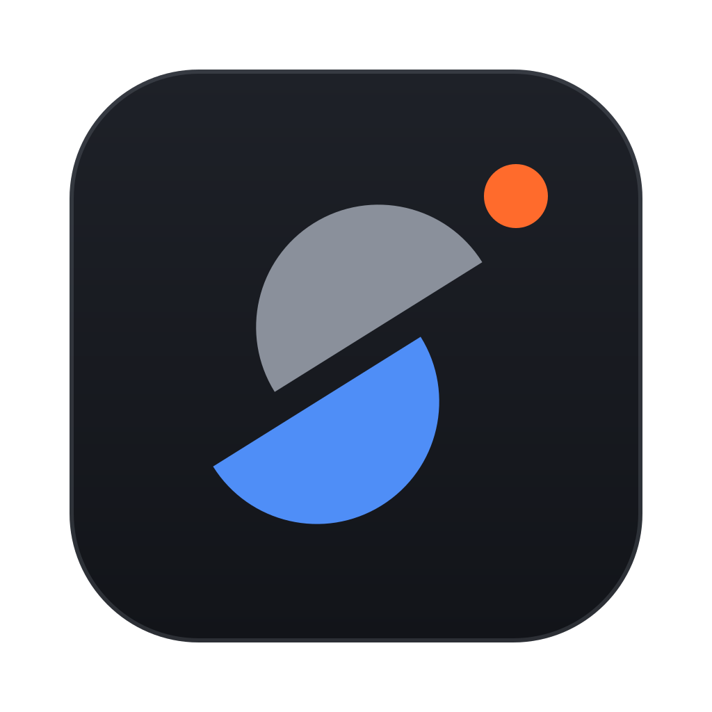
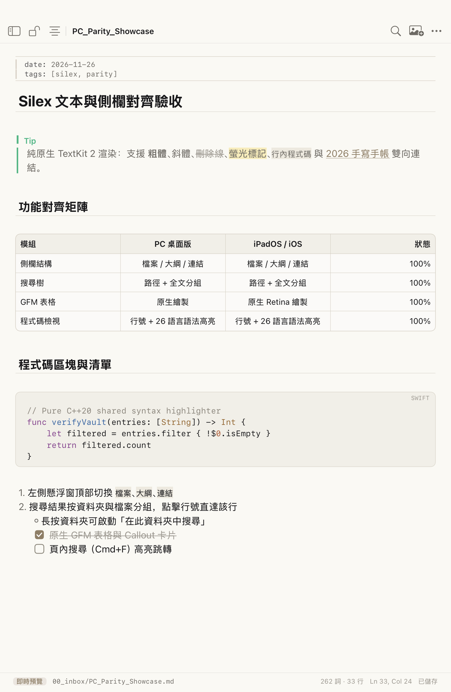
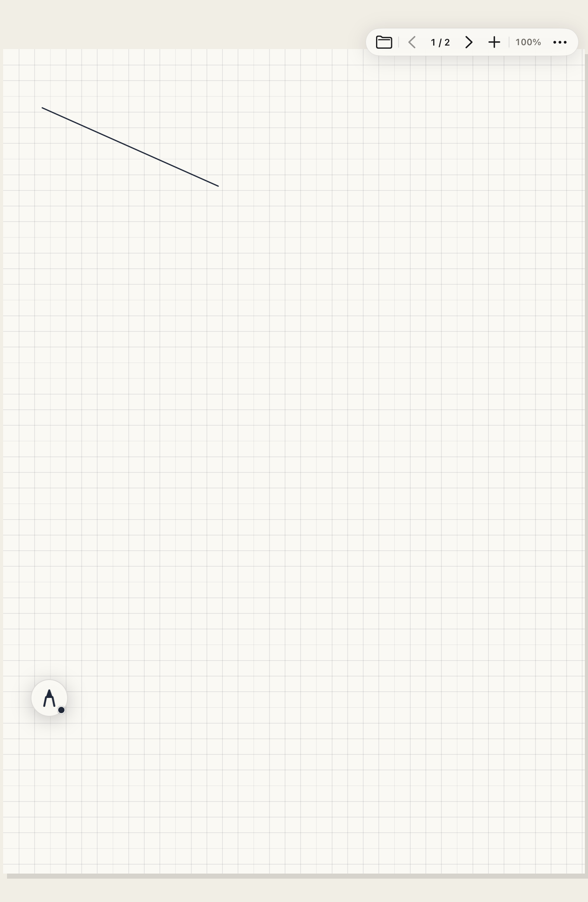

<p align="center">
  
</p>

<h1 align="center">SilexNib</h1>

<p align="center">
  <strong>Offline Local Markdown, Physical Handwriting Notebooks & Zero-Server Cross-Device Sync — Completely Free.</strong>
</p>

<p align="center">
  English ·
  <a href="readme/README.zh-TW.md">繁體中文（台灣）</a> ·
  <a href="readme/README.ja.md">日本語</a> ·
  <a href="readme/README.ko.md">한국어</a> ·
  <a href="readme/README.de.md">Deutsch</a>
</p>

<p align="center">
  <a href="https://keithxc.github.io/silexnib/">Website</a> ·
  <a href="https://github.com/keithxc/silexnib/releases">Releases</a> ·
  <a href="spec/FORMAT.md">Open Handwriting Format (ILP1 / .snb)</a> ·
  <a href="https://keithxc.github.io/silexnib/privacy.html">Privacy Policy</a> ·
  <a href="https://keithxc.github.io/silexnib/support.html">Support</a>
</p>

---

## Overview

**SilexNib** is a **100% pure-native**, offline-first personal knowledge base and physical page-by-page handwriting notebook across **macOS, Linux, iPadOS, and iOS**.

- **Zero Electron / Zero WebView / Zero JavaScript Runtime**: Built with native C++20, Qt 6 Widgets (macOS & Linux), and UIKit + Metal + PDFKit + Network.framework (iPad & iPhone).
- **100% Free Forever**: No subscriptions, no ads, no accounts, no telemetry, and no cloud lock-in.
- **Your Files Stay Yours**: Standard UTF-8 Markdown (`.md`), portable per-note asset bundles (`./<note>.assets/`), plain-text/code files, native PDFs, and **openly documented handwriting formats (`ILP1` & `*.snb/`)**.

<p align="center">
  
  &nbsp;
  
</p>

---

## Supported Platforms

| Platform | Engine | Capabilities |
| --- | --- | --- |
| **macOS (Apple Silicon)** | Pure C++20 + Qt 6 + AppKit + PDFKit | Full Markdown Live Preview, Daily Notes, code/plain-text, PDF, mouse/keyboard `.snb`/`.ilp` editing, built-in mTLS 1.3 LAN/Tailscale sync, vault migration |
| **Linux (Wayland / X11)** | Pure C++20 + Qt 6 + PDFium | Full desktop parity with frameless native chrome, Fcitx5 CJK IME, mouse/keyboard `.snb`/`.ilp` editing, built-in mTLS 1.3 sync |
| **iPadOS (iPad)** | Pure C++20 + Swift + UIKit + Metal + PDFKit | Flagship Apple Pencil page-by-page handwriting (`0%` idle CPU), Live Preview Markdown, Daily Notes, PDF, global search, QR-paired LAN/Tailscale sync into App Private Storage |
| **iOS (iPhone)** | Pure C++20 + Swift + UIKit + Metal + PDFKit | Full Markdown/Daily Notes/plain-text editing, PDF & full-text search, QR-paired LAN/Tailscale sync; handwriting notebooks (`.snb`/`.ilp`) are **view-only + export** (zoom, pan, flip pages, export PDF/`.xopp`) |

---

## Key Features

### 1. Local Markdown, Daily Notes & Plain Text
- Pure-native **Live Preview** editing (headings, callouts, GFM tables, syntax-highlighted code blocks, wikilinks `[[path|alias]]`, checklists, and automatic link rewriting on rename).
- Drop-in Daily Notes (`00_inbox/daily/YYYY-MM-DD.md` + template expansion).
- Portable per-note assets (`./<note_stem>.assets/`) that automatically move/rename alongside the note.
- Fast global filename + full-text search and native syntax highlighting for 26+ programming & config languages.

### 2. Physical Page-by-Page Handwriting Notebooks (`*.snb/` + `ILP1`)
- Modeled on real paper planners (`A5`, `B5`, `A4`, `iPad 3:4`; `Grid`, `Ruled`, `Dotted`, `Blank`) — no disorienting infinite canvas.
- Event-driven Metal rendering on iPad (~0% idle CPU) with calibrated brushes, lasso move, text boxes, and page overview.
- One-click export to **multi-page vector PDF (`.pdf`)** and **Xournal++ (`.xopp`)**.

### 3. Built-in Zero-Server Cross-Device Sync (mTLS 1.3 over LAN / Tailscale)
- **No cloud accounts or relay servers**: Direct peer-to-peer TLS 1.3 with ECDSA P-256 leaf certificate SHA-256 fingerprint pinning.
- **Minimalist QR Pairing**: Scan a one-time 5-minute QR code from Desktop SilexNib to bind iPad/iPhone; desktop-to-desktop mutual approval over LAN or Tailscale.
- **Safe Local Storage by Default**:
  - **iPad / iPhone**: Automatically creates an isolated empty vault in App Private Storage (`On My iPad/iPhone → Silex → <VaultName>`) and pulls cleanly from zero.
  - **macOS / Linux**: Defaults to `~/silexnib/<VaultName>` (customizable) and includes in-app **Move Vault Location…** migration without re-pairing, plus a background auto-sync switch (auto-enabled once paired, toggleable manually or declaratively via Nix).
- **Anti-Black-Hole Safety**: Demo Vault is hard-excluded from sync, manifests/baselines are isolated per vault, deletions move safely to `99_trash/`, `.ilp` & `.snb` merge losslessly via HLC + tombstones, and a mass-deletion circuit breaker halts sync if `>80%` of `>=10` files suddenly vanish.

---

## Open Handwriting Protocol — Ecosystem Interoperability Welcome!

While SilexNib's application binaries are distributed free of charge with proprietary source code, **the handwriting file formats (`ILP1` `*.ilp` and `*.snb/`) are completely open and dedicated to the Public Domain ([CC0 1.0](LICENSE-SPEC))**.

- Full binary & JSON specification: **[`spec/FORMAT.md`](spec/FORMAT.md)**
- Single-header pure C99 codec & CRDT merger (`stb` style, zero dependencies): **[`spec/ilp1.h`](spec/ilp1.h)** (tests: [`spec/ilp1_test.c`](spec/ilp1_test.c))
- Zero-dependency Python 3 reference parser & inspector: **[`spec/ilp1_tool.py`](spec/ilp1_tool.py)**

We warmly encourage other Markdown editors, handwriting apps, sync tools, and converters to read, write, and interoperate with `ILP1` and `*.snb/`!

---

## Downloads & Nix Binary Installation

- **iPad & iPhone**: Available via Apple App Store / TestFlight (**SilexNib**)
- **macOS (Apple Silicon)**: Download signed `.dmg` or `.zip` from **[GitHub Releases](https://github.com/keithxc/silexnib/releases)**
- **Linux (x86_64, `glibc >= 2.39`)**: Download native packages from **[GitHub Releases](https://github.com/keithxc/silexnib/releases)**:
  - **Debian / Ubuntu / Mint / Pop!_OS**: `silex_<ver>_amd64.deb` (`sudo apt install ./silex_<ver>_amd64.deb`)
  - **Fedora / openSUSE / RHEL / Bazzite**: `silex-<ver>.x86_64.rpm` (`sudo dnf install ./silex-<ver>.x86_64.rpm`)
  - **Arch / CachyOS / Manjaro**: `silex-<ver>-x86_64.pkg.tar.zst` (`sudo pacman -U ./silex-<ver>-x86_64.pkg.tar.zst`)
  - **Universal AppImage**: `Silex-<ver>-x86_64.AppImage` (`chmod +x` and run)
  - **Flatpak**: `Silex-<ver>-x86_64.flatpak` (`flatpak install --user ./Silex-<ver>-x86_64.flatpak`)
  - **Portable tarball**: `silex-<ver>-linux-x86_64.tar.gz`
- **NixOS / nix-darwin / Home Manager (Prebuilt Binary Flake)**:
  ```bash
  # Run directly without compiling from source
  nix run github:keithxc/silexnib
  ```
  Or add `inputs.silex.url = "github:keithxc/silexnib";` to your system flake and enable `services.silex.enable = true;` (`nixosModules.silex` / `darwinModules.silex`) or `programs.silex.enable = true;` (`homeManagerModules.silex`).
- **License & Notices**: Free proprietary binaries ([LICENSE](LICENSE)); third-party open-source attributions including dynamically linked Qt 6 (LGPL-3.0) and PDFium (Apache-2.0/BSD-3-Clause) in [THIRD_PARTY_LICENSES.md](THIRD_PARTY_LICENSES.md).
- **UI Languages**: Strictly 5 languages — English (`en`), Taiwan Traditional Chinese (`zh-TW`), Japanese (`ja`), Korean (`ko`), and German (`de`)
- **Privacy & Support**: [Privacy Policy](https://keithxc.github.io/silexnib/privacy.html) · [Support & FAQ](https://keithxc.github.io/silexnib/support.html) · [Report an Issue](https://github.com/keithxc/silexnib/issues)
