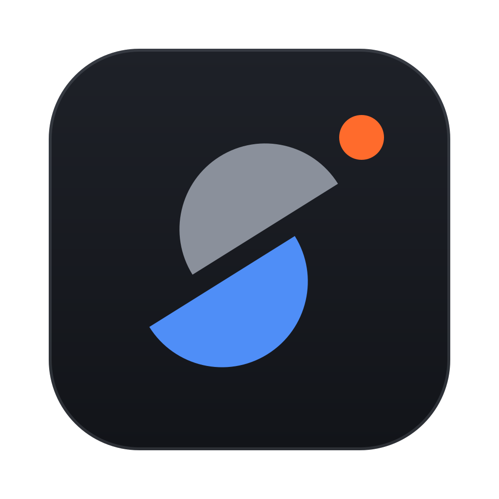

  

<h1 align="center">SilexNib</h1>

  <strong>Offline-Markdown, seitenbasierte Handschrift-Notizbücher & serverlose Synchronisierung — komplett gratis.</strong>

  <a href="../README.md">English</a> ·
  <a href="README.zh-TW.md">繁體中文（台灣）</a> ·
  <a href="README.ja.md">日本語</a> ·
  <a href="README.ko.md">한국어</a> ·
  Deutsch

  <a href="https://keithxc.github.io/silexnib/">Webseite</a> ·
  <a href="https://github.com/keithxc/silexnib/releases">Downloads</a> ·
  <a href="../spec/FORMAT.md">Offenes Handschrift-Format (ILP1 / .snb)</a> ·
  <a href="https://keithxc.github.io/silexnib/privacy.html">Datenschutz</a> ·
  <a href="https://keithxc.github.io/silexnib/support.html">Support</a>

---

## Überblick

**SilexNib** ist eine **100 % native**, offline-orientierte Wissensdatenbank und Handschrift-Notizbuch-App für **macOS, Linux, iPadOS und iOS**.

- **Kein Electron, kein WebView, keine JS-Laufzeit**: Kompilierter C++20-Kern, Qt 6 Widgets (Desktop) sowie UIKit + Metal + PDFKit + Network.framework (iPad & iPhone).
- **Dauerhaft kostenlos**: Keine Abos, keine Werbung, kein Konto, keine Telemetrie.
- **Volle Datenhoheit**: Reines UTF-8-Markdown (`.md`), portable Anhangsordner (`./<Notiz>.assets/`), Klartext/Code, PDFs und **offen dokumentierte Handschrift-Formate (`ILP1` & `*.snb/`)**.

## Highlights

- **Native Live-Vorschau & Tagesnotizen**: GFM-Tabellen, Callouts, Syntax-Highlighting für 26+ Sprachen, `[[Wikilinks]]` mit automatischer Link-Aktualisierung beim Umbenennen.
- **Seitenbasierte Handschrift-Notizbücher (`*.snb/` + `ILP1`)**: Feste Papierformate (A5 / B5 / A4 / iPad 3:4). Auf dem iPad ereignisgesteuertes Metal-Rendering (~0 % Leerlauf-CPU) mit Apple Pencil; auf dem iPhone schreibgeschützte Ansicht & Export als Vektor-PDF oder Xournal++ (`.xopp`).
- **Serverlose mTLS-1.3-Synchronisierung (LAN / Tailscale)**: Einmal-QR-Code-Kopplung mit Zertifikats-Fingerabdruck-Pinning. iPad/iPhone nutzen automatisch den privaten App-Speicher, PC nutzt standardmäßig `~/silexnib/<Tresor>` inklusive Tresor-Umzug, Hintergrund-Synchronisierungsschalter (nach Kopplung automatisch aktiv, manuell oder deklarativ via Nix steuerbar) und Schutz vor Massenlöschung.

## Offenes Handschrift-Protokoll — Kompatibilität willkommen

Die SilexNib-Anwendung ist kostenlos nutzbar (Quellcode proprietär), während **die Dateiformate `ILP1` und `*.snb/` vollständig offen unter [CC0 1.0 Public Domain](../LICENSE-SPEC) stehen**:

- Spezifikation: [`spec/FORMAT.md`](../spec/FORMAT.md)
- Single-Header-C99-Codec & CRDT-Merger (`stb`-Stil, ohne Abhängigkeiten): [`spec/ilp1.h`](../spec/ilp1.h) (Tests: [`spec/ilp1_test.c`](../spec/ilp1_test.c))
- Python-3-Referenzparser: [`spec/ilp1_tool.py`](../spec/ilp1_tool.py)

Andere Apps und Konverter sind herzlich eingeladen, `ILP1` und `*.snb/` zu unterstützen.

## Downloads & Nix-Binärinstallation

- **iPad / iPhone**: Apple App Store / TestFlight (**SilexNib**)
- **macOS / Linux (x86_64, `glibc >= 2.39`)**: `.dmg` / `.zip` sowie `.deb`, `.rpm`, `.pkg.tar.zst`, `.AppImage`, `.flatpak` und `.tar.gz` über [GitHub Releases](https://github.com/keithxc/silexnib/releases)
- **NixOS / nix-darwin / Home Manager**: `nix run github:keithxc/silexnib` (inkl. `nixosModules.silex`, `darwinModules.silex`, `homeManagerModules.silex`)
- **Lizenz**: Kostenlose proprietäre Binärpakete ([LICENSE](../LICENSE)), Drittanbieter-Hinweise in [THIRD_PARTY_LICENSES.md](../THIRD_PARTY_LICENSES.md)
- Feedback & Fehlerberichte: [GitHub Issues](https://github.com/keithxc/silexnib/issues)
