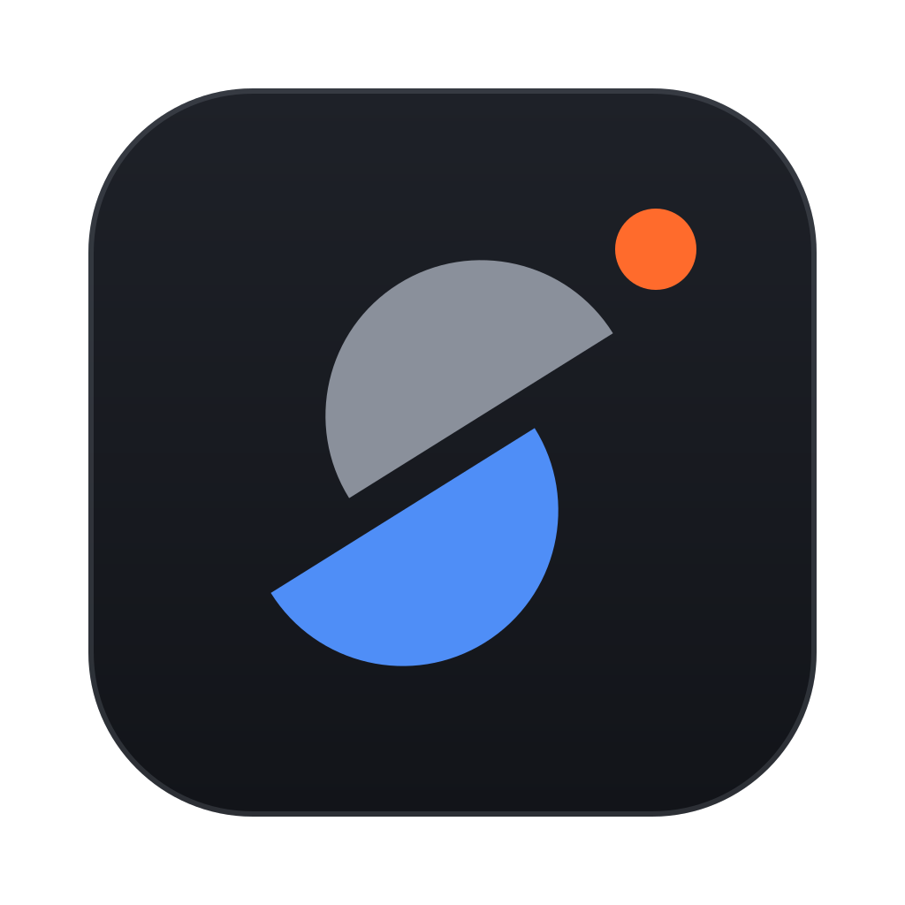

  

<h1 align="center">SilexNib</h1>

  <strong>オフラインローカル Markdown・ページ単位手書きノート・サーバーレス同期 — 完全無料。</strong>

  <a href="../README.md">English</a> ·
  <a href="README.zh-TW.md">繁體中文（台灣）</a> ·
  日本語 ·
  <a href="README.ko.md">한국어</a> ·
  <a href="README.de.md">Deutsch</a>

  <a href="https://keithxc.github.io/silexnib/">公式サイト</a> ·
  <a href="https://github.com/keithxc/silexnib/releases">ダウンロード</a> ·
  <a href="../spec/FORMAT.md">オープン手書き仕様 (ILP1 / .snb)</a> ·
  <a href="https://keithxc.github.io/silexnib/privacy.html">プライバシーポリシー</a> ·
  <a href="https://keithxc.github.io/silexnib/support.html">サポート</a>

---

## 概要

**SilexNib** は **macOS・Linux・iPadOS・iOS** 向けの **100% ピュアネイティブ**、オフラインファーストな個人ナレッジベース兼手書きノートアプリです。

- **Electron / WebView / JS ランタイム一切不使用**：C++20・Qt 6 Widgets（デスクトップ）および UIKit + Metal + PDFKit + Network.framework（iPad / iPhone）で構成。
- **完全無料**：サブスクリプションなし、広告なし、アカウント不要、テレメトリなし。
- **オープンなファイル形式**：標準 UTF-8 Markdown（`.md`）、ポータブル添付フォルダ（`./<ノート名>.assets/`）、プレーンテキスト/コード、PDF、そして**完全公開の手書き仕様（`ILP1` / `*.snb/`）**。

## 主な機能

- **ライブプレビュー Markdown & デイリーノート**：GFM テーブル、Callout、26 以上の言語シンタックスハイライト、`[[wikilinks]]` とリネーム時のリンク自動更新。
- **紙のノート型手書き（`*.snb/` + `ILP1`）**：A5 / B5 / A4 / iPad 3:4 の固定ページ設計。iPad では Apple Pencil によるイベント駆動 Metal 描画（待機時 CPU ~0%）、iPhone では閲覧・PDF / `.xopp` 書き出しに対応。
- **サーバー不要の mTLS 1.3 LAN / Tailscale 同期**：ワンタイム QR コードで簡単ペアリング。iOS/iPadOS はアプリ専用領域（`Documents/<保管庫名>`）へ自動同期、PC はデフォルト `~/silexnib/<保管庫名>`＋アプリ内保管庫移動・バックグラウンド自動同期スイッチ（ペアリング後自動有効、手動切替・Nix 宣言設定対応）・大量削除保護を搭載。

## オープン手書きプロトコル（互換実装を歓迎します）

アプリ本体は無料で配布（ソース非公開）していますが、**手書きファイル形式（`ILP1` と `*.snb/`）は [CC0 1.0 パブリックドメイン](../LICENSE-SPEC) として完全公開**しています。

- 仕様書：[`spec/FORMAT.md`](../spec/FORMAT.md)
- 単一ヘッダー純 C99 コーデック＆CRDT マージ（`stb` 形式・依存ゼロ）：[`spec/ilp1.h`](../spec/ilp1.h)（テスト：[`spec/ilp1_test.c`](../spec/ilp1_test.c)）
- Python 3 リファレンスパーサー：[`spec/ilp1_tool.py`](../spec/ilp1_tool.py)

他社ノートアプリ・変換ツールからの読み書き互換実装を歓迎します。お問い合わせ・バグ報告は [GitHub Issues](https://github.com/keithxc/silexnib/issues) へどうぞ。
