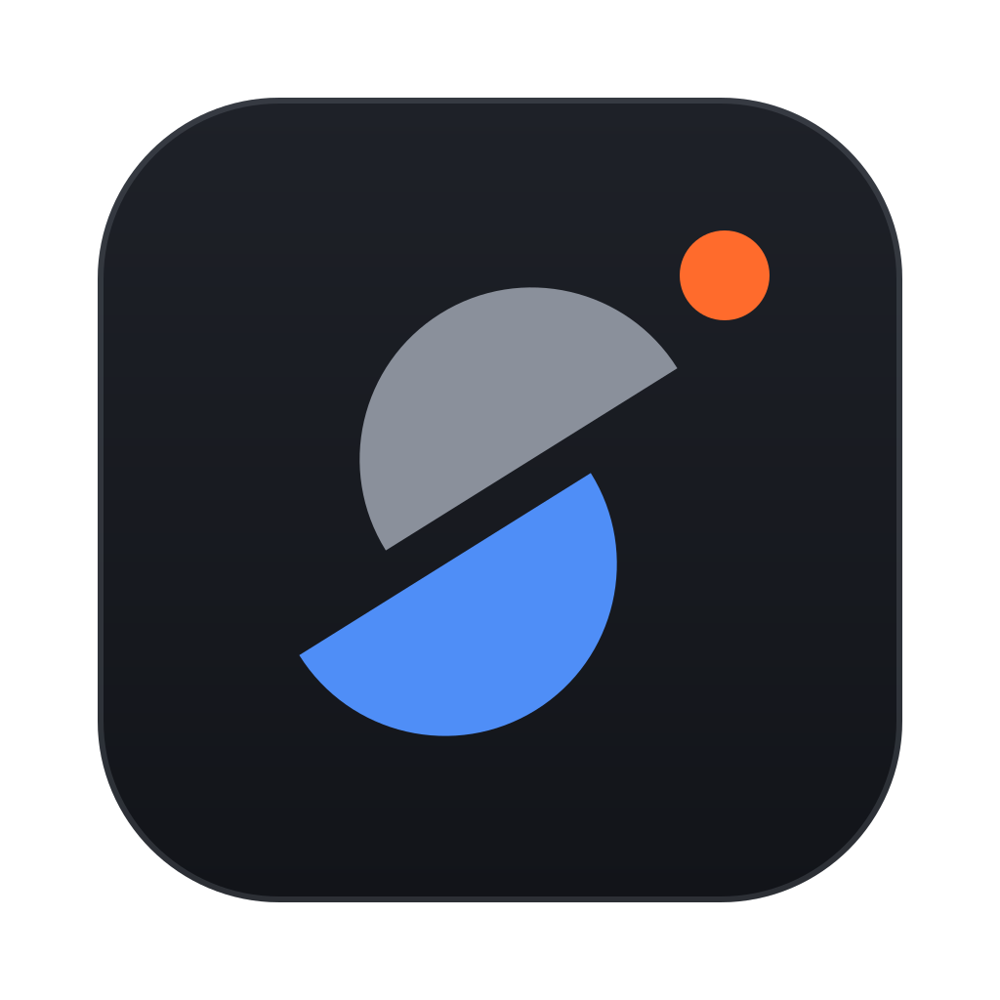

  

<h1 align="center">SilexNib</h1>

  <strong>오프라인 로컬 Markdown, 페이지 단위 필기 노트, 서버 없는 기기 간 동기화 — 완전 무료.</strong>

  <a href="../README.md">English</a> ·
  <a href="README.zh-TW.md">繁體中文（台灣）</a> ·
  <a href="README.ja.md">日本語</a> ·
  한국어 ·
  <a href="README.de.md">Deutsch</a>

  <a href="https://keithxc.github.io/silexnib/">웹사이트</a> ·
  <a href="https://github.com/keithxc/silexnib/releases">다운로드</a> ·
  <a href="../spec/FORMAT.md">오픈 필기 포맷 규격 (ILP1 / .snb)</a> ·
  <a href="https://keithxc.github.io/silexnib/privacy.html">개인정보 처리방침</a> ·
  <a href="https://keithxc.github.io/silexnib/support.html">지원 및 FAQ</a>

---

## 소개

**SilexNib**는 **macOS, Linux, iPadOS, iOS**를 지원하는 **100% 네이티브** 오프라인 우선 개인 지식 관리 및 필기 노트 앱입니다.

- **Electron / WebView 없음**: 순수 C++20, Qt 6 Widgets(데스크톱), UIKit + Metal + PDFKit + Network.framework(iPad / iPhone)로 제작.
- **평생 무료**: 구독 없음, 광고 없음, 계정 없음, 텔레메트리 없음.
- **데이터 소유권 보장**: 표준 UTF-8 Markdown(`.md`), 노트별 포터블 첨부 폴더(`./<노트>.assets/`), 일반 텍스트/코드, PDF, 그리고 **완전 공개된 필기 포맷(`ILP1` & `*.snb/`)**.

## 주요 기능

- **라이브 프리뷰 Markdown & 데일리 노트**: GFM 표, Callout, 26개 이상 언어 구문 강조, `[[위키링크]]` 및 이름 변경 시 자동 링크 갱신.
- **종이 노트 방식 필기(`*.snb/` + `ILP1`)**: A5 / B5 / A4 / iPad 3:4 고정 페이지 구성. iPad에서는 Apple Pencil 이벤트 기반 Metal 렌더링(유휴 CPU ~0%), iPhone에서는 필기 노트 읽기 전용 열람 및 벡터 PDF / `.xopp` 내보내기 지원.
- **서버 없는 mTLS 1.3 LAN / Tailscale 동기화**: 일회용 QR 코드로 간편 페어링. iOS/iPadOS는 앱 전용 저장소(`Documents/<보관함>`)에 자동 동기화되며, PC는 기본 `~/silexnib/<보관함>` 경로, 앱 내 보관함 위치 이동, 백그라운드 자동 동기화 스위치(페어링 시 자동 켜짐, 수동/Nix 선언적 설정 지원) 및 대량 삭제 방지 차단기를 제공합니다.

## 오픈 필기 프로토콜 — 호환 구현 환영

SilexNib 앱 바이너리는 무료로 배포(소스 비공개)되지만, **필기 파일 포맷(`ILP1` 및 `*.snb/`)은 [CC0 1.0 퍼블릭 도메인](../LICENSE-SPEC)으로 완전 공개**되어 있습니다.

- 포맷 명세: [`spec/FORMAT.md`](../spec/FORMAT.md)
- 단일 헤더 순수 C99 코덱 & CRDT 병합 라이브러리(`stb` 스타일, 의존성 없음): [`spec/ilp1.h`](../spec/ilp1.h) (테스트: [`spec/ilp1_test.c`](../spec/ilp1_test.c))
- Python 3 참조 파서: [`spec/ilp1_tool.py`](../spec/ilp1_tool.py)

다른 노트 앱과 변환 도구의 호환 구현을 환영합니다. 버그 제보 및 제안은 [GitHub Issues](https://github.com/keithxc/silexnib/issues)를 이용해 주세요.
