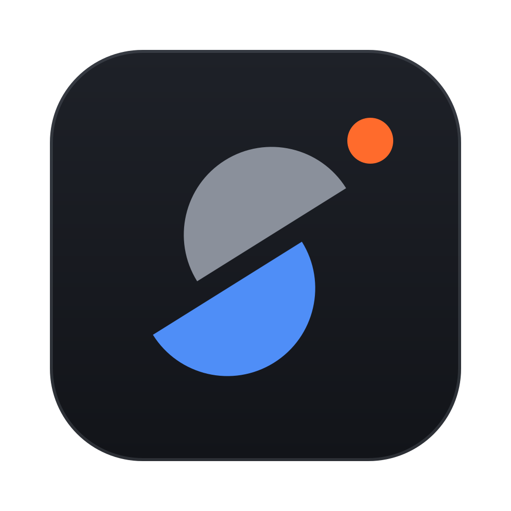

  

<h1 align="center">SilexNib</h1>

  <strong>離線本地 Markdown、實體分頁手寫筆記本與零伺服器跨裝置同步 — 完全免費。</strong>

  <a href="../README.md">English</a> ·
  繁體中文（台灣） ·
  <a href="README.ja.md">日本語</a> ·
  <a href="README.ko.md">한국어</a> ·
  <a href="README.de.md">Deutsch</a>

  <a href="https://keithxc.github.io/silexnib/">官方網站</a> ·
  <a href="https://github.com/keithxc/silexnib/releases">下載版本</a> ·
  <a href="../spec/FORMAT.md">開放手寫格式規範（ILP1 / .snb）</a> ·
  <a href="https://keithxc.github.io/silexnib/privacy.html">隱私權政策</a> ·
  <a href="https://keithxc.github.io/silexnib/support.html">支援與常見問題</a>

---

## 簡介

**SilexNib** 是一款 **100% 純原生編譯**、離線優先的跨裝置個人知識庫與手寫筆記本，涵蓋 **macOS、Linux、iPadOS 與 iOS**。

- **零 Electron、零 WebView、零 JavaScript 執行期**：以純 C++20、Qt 6 Widgets（macOS / Linux）與 UIKit + Metal + PDFKit + Network.framework（iPad / iPhone）打造。
- **永久免費**：無訂閱、無廣告、無帳號登入、無遙測追蹤、無雲端鎖定。
- **資料永遠屬於你**：標準 UTF-8 Markdown（`.md`）、可攜式單篇附件資料夾（`./<筆記名>.assets/`）、純文字/程式碼、原生 PDF，以及**完全公開的手寫格式（`ILP1` 與 `*.snb/`）**。

---

## 核心特色

1. **流暢本地 Markdown、每日日記與純文字編輯**
   - 純原生即時預覽（Live Preview），支援標題、Callout、GFM 表格、26+ 程式語言原生語法高亮、雙向連結 `[[path|alias]]` 與重新命名自動更新連結。
   - 支援每日日記（`00_inbox/daily/YYYY-MM-DD.md`）與範本展開，以及可攜式 `./<筆記名>.assets/` 圖片附件。
2. **真實實體分頁手寫筆記本（`*.snb/` + `ILP1`）**
   - 模擬真實紙本手帳（`A5`、`B5`、`A4`、`iPad 3:4`；方格、橫線、點陣、空白），拒絕令人迷失的無限畫布。
   - iPad 端事件驅動 Metal 繪圖（靜止 CPU 接近 0%），支援 Apple Pencil 筆刷、套索移動、文字方塊；iPhone 端提供手寫筆記唯讀檢視與匯出。
   - 一鍵匯出**多頁向量 PDF（`.pdf`）**與 **Xournal++（`.xopp`）**。
3. **內建零伺服器跨裝置同步（LAN / Tailscale mTLS 1.3）**
   - 裝置間點對點直連加密（ECDSA P-256 證書 SHA-256 指紋釘紮），無任何中繼或雲端伺服器。
   - 行動裝置掃描桌面端一次性 QR 碼即可完成配對，自動在 App 私有目錄建立同名知識庫從 0 拉取；電腦端預設存放於 `~/silexnib/<知識庫名>`，支援軟體內無縫遷移庫位置與背景自動同步開關（配對後自動開啟，可手動關閉或由 Nix 宣告式管理）。
   - 內建按庫隔離狀態、示範庫禁同步、`99_trash/` 安全軟刪除、`.ilp`/`.snb` 無損筆跡合併，以及大量刪除防黑洞熔斷保護。

---

## 開放手寫格式規範（歡迎生態系相容互通）

SilexNib 應用程式免費提供使用（程式碼不開源），但**底層手寫檔案格式（`ILP1` 與 `*.snb/`）以 [CC0 1.0 公眾領域](LICENSE-SPEC) 完全公開**：

- 完整二進位與 JSON 規範：**[`spec/FORMAT.md`](../spec/FORMAT.md)**
- 單標頭檔純 C99 編解碼與 CRDT 合併庫（`stb` 風格、零外部相依）：**[`spec/ilp1.h`](../spec/ilp1.h)**（測試：[`spec/ilp1_test.c`](../spec/ilp1_test.c)）
- 零相依 Python 3 參考解析工具：**[`spec/ilp1_tool.py`](../spec/ilp1_tool.py)**

誠摯歡迎其他筆記軟體、手寫應用與轉換工具實作相容，讓手寫筆記永久開放流通。

---

## 下載與回饋

- **iPad / iPhone**：透過 Apple App Store / TestFlight 安裝 **SilexNib**
- **macOS / Linux**：前往 **[GitHub Releases](https://github.com/keithxc/silexnib/releases)** 下載
- **隱私權政策**：[https://keithxc.github.io/silexnib/privacy.html](https://keithxc.github.io/silexnib/privacy.html)
- **問題回報與建議**：[GitHub Issues](https://github.com/keithxc/silexnib/issues)
